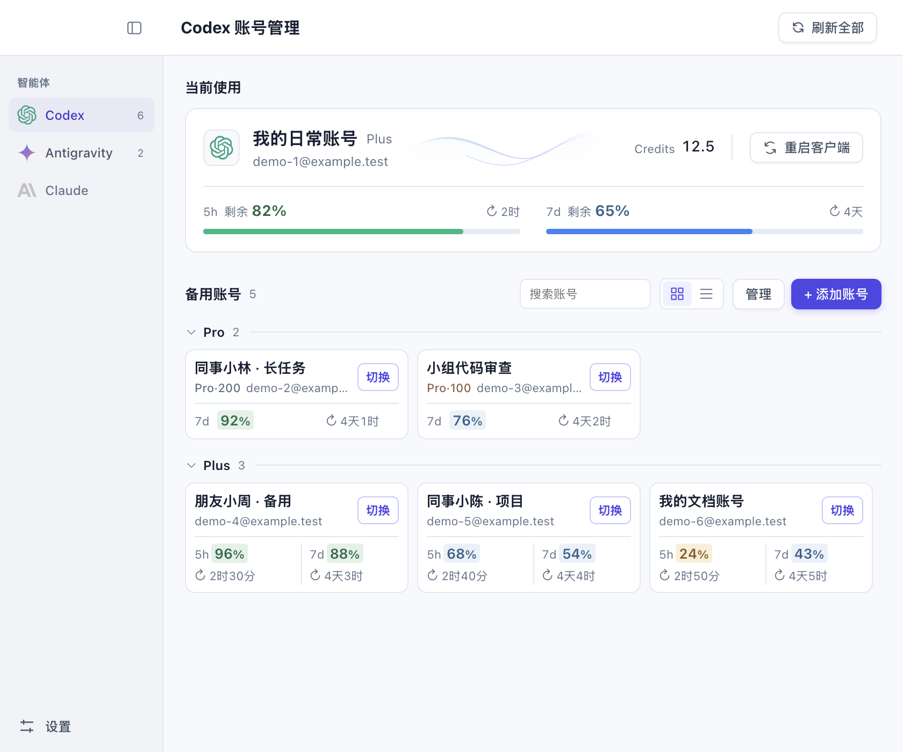
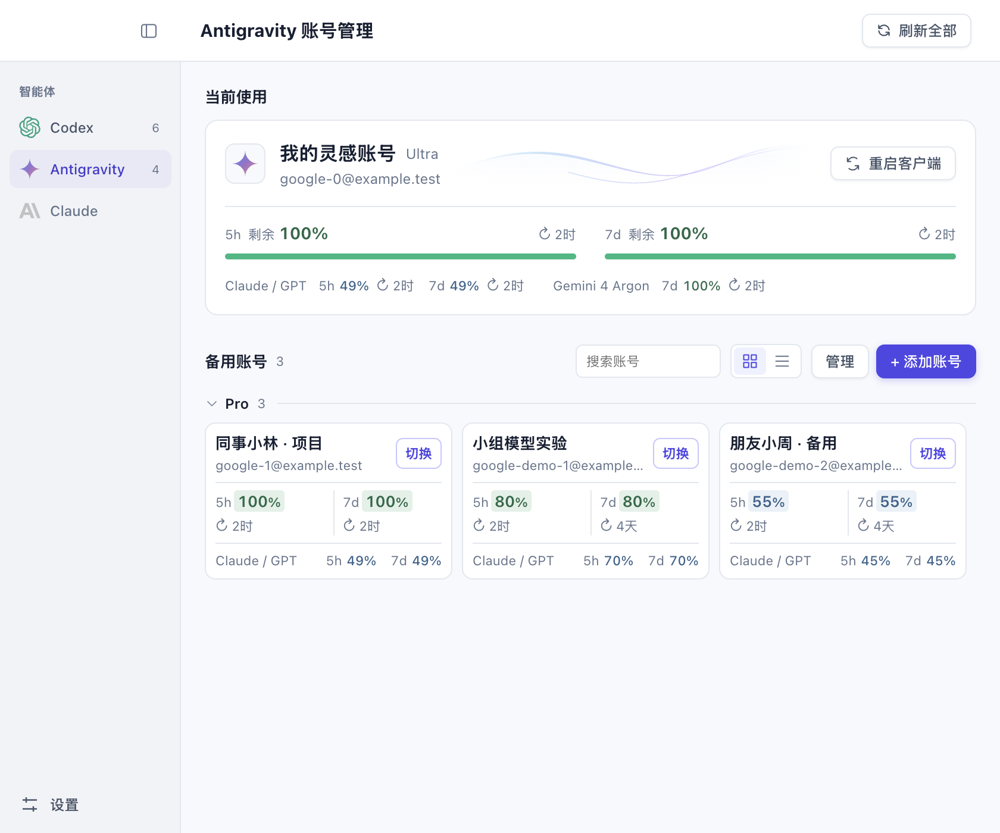
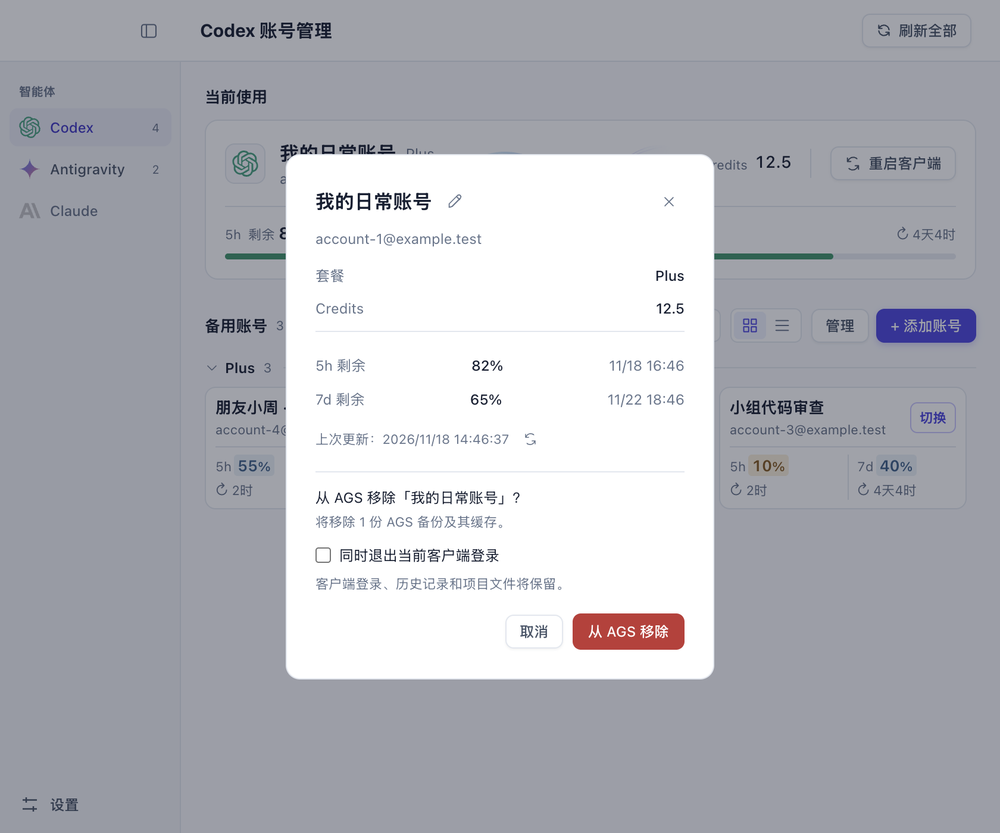

<div align="center">
  
  <h1>AgentSwitcher · AGS</h1>
  <p><a href="README.md">中文</a> · <strong>English</strong> · <a href="site/">Landing page source (GitHub Pages)</a></p>
  <p><strong>Side by side with your agents, walking together toward the AGI gate.</strong></p>
  <p>
    Whether you juggle multiple personal and team accounts, or borrow a teammate’s <strong>Codex</strong> or <strong>Antigravity</strong> account in a crunch —<br />
    put them in one macOS desktop window: see who still has quota left at a glance, switch in one click without breaking flow or overwriting your unsaved primary login.
  </p>
  <p>
    <a href="docs/release-1.0.1.md"></a>
    
    
    
    <a href="LICENSE"></a>
  </p>
  <p>
    <a href="https://github.com/xjzc-mt/agent-switcher/releases">Release history</a> ·
    <a href="#visual-tour">Visual Tour</a> ·
    <a href="#security--platform-support">Security &amp; Support</a> ·
    <a href="#quick-install">Quick Install</a> ·
    <a href="docs/release-1.0.1.md">1.0.1 Candidate Notes</a> ·
    <a href="#beyond-the-gate">✦ Beyond the Gate</a>
  </p>
</div>



<p align="center"><sub>Real desktop screenshots using mock accounts and simulated quotas (no real credentials included)</sub></p>

---

## Visual Tour

### 1. Check quota without guessing

Your active account stays pinned at the top while backup accounts are grouped by plan and sorted by remaining availability in **Card** or **Row** view. Codex separates `5h / 7d` windows and Credits; Antigravity leads with `Gemini` and shows `Claude / GPT` model groups independently, rendering missing values honestly as `—` without blending totals.

| Codex Row View · Compact aligned comparison | Antigravity · Primary & secondary model groups |
| --- | --- |
|  |  |

### 2. Add accounts without signing out

Launch the official browser flow (with incognito and continuous-add support) to authorize new accounts **without kicking out your active desktop client**. Multi-account JSON imports let you preview, rename, and deduplicate by identity first; expired accounts can be refreshed in place while keeping their nickname, and replacement files verify ownership before overwriting (see [Import Format](docs/session-import.md)).

| Isolated Browser Login · Incognito & continuous add | Batch Import Preview · Rename, dedup & in-place update |
| --- | --- |
|  |  |

### 3. Back up and remove without collateral damage

Select accounts and set a dedicated password to export an encrypted `.ags` archive for cross-Mac migration. Before removal, AGS lays out the exact matching scope — **by default only AGS backups are deleted**, leaving your official client login, chat history, and project files untouched.

| Encrypted Export · Password-protected `.ags` archive | Safe Removal · Keeps client state by default |
| --- | --- |
|  |  |

---

## Security & Platform Support

- **Zero custom backend, open to audit**: No proprietary servers, no analytics SDKs, and no telemetry. Sign-in only allows official OpenAI and Google auth domains, and you can also run straight from source.
- **Strong local encryption**: Pool credentials are encrypted with `AES-256-GCM` (`0600` file permissions) with the master key held in macOS Keychain; `.ags` exports derive their key from your own backup password.
- **No silent overwrites or side effects**: Switching away from an unsaved active login triggers a protection prompt first. AGS only swaps login credentials — never touching chat history or project configs, and never auto-switching in the background.
- **Clear boundaries**: Only add someone else’s account with explicit permission; this release is strictly local to your machine. See [Account Management Flow](docs/account-management.md) and [Quota Refresh](docs/refresh-behavior.md) for details (docs in Chinese).

| Platform | Status | macOS Support & Requirements |
| --- | :---: | --- |
| **Codex** (`codex`) | ✅ Supported | Isolated sign-in, `auth.json` switching, `5h / 7d` quota & Credits (requires local Codex app; Keychain-only not yet adapted; API keys have no subscription quota) |
| **Antigravity** (`agy`) | ✅ Supported | macOS 2.x personal Google account isolated sign-in, Keychain or official file switching & model-group quotas (requires official `agy` CLI; enterprise auth unverified) |
| **Claude Code** (`claude`) | 🚧 Planned | Core compatibility code retained; GUI entry disabled in v1.0 until activation and quota capabilities are ready |

The 1.0.1 candidate targets **macOS on Apple Silicon** and includes the desktop app and the `ags` CLI. Windows compatibility for Codex is still awaiting testing on Windows.

---

## Quick Install

This workspace contains the **1.0.1 source candidate**. From a checkout that includes these changes, run `npm ci && npm run build && npm run gui`. The macOS menu bar lets you hover to choose an account and stays on the display where you opened it when you switch tabs. See the [1.0.1 candidate notes](docs/release-1.0.1.md).

Official installers are listed on [GitHub Releases](https://github.com/xjzc-mt/agent-switcher/releases). When a release includes the Apple Silicon DMG, open it and drag the app into **Applications**. Install the corresponding official client and finish active tasks before switching. AGS can quit and relaunch the desktop client after confirmation. For Antigravity, close any shared `agy` or IDE sessions first.

```bash
shasum -a 256 -c SHA256SUMS   # Optional: place DMG and SHA256SUMS in the same folder to verify integrity
```

> [!IMPORTANT]
> Initial builds use **ad-hoc signing** (not yet Apple notarized). If macOS reports that the developer cannot be verified on first launch, verify the download source, then open **System Settings → Privacy & Security**, scroll to the bottom, and click **Open Anyway**.

In the current source build, open **Settings → App & Updates → Export diagnostic report** to save a redacted record of recent operations. You can share it privately with a maintainer. You can also check [Known Issues](issues/README.md) or file a report on [GitHub Issues](https://github.com/xjzc-mt/agent-switcher/issues). **Never upload real credential JSON, tokens, or backup passwords.**

<details>
<summary><strong>Preferences & In-App Updates</strong></summary>

Settings let you switch reset-time format (countdown / date-time), choose incognito sign-in behavior, copy the Codex cleanup helper prompt, and check/download newer DMG releases inside the app. Current source verifies release manifests with a bundled Ed25519 public key and checks the installer SHA-256. See [In-App Updates](docs/app-updates.md).


</details>

<details>
<summary><strong>Run from Source, <code>ags</code> CLI &amp; Developer Docs</strong></summary>

Requires **Node.js 22.12+**, npm, and a graphical desktop session (the DMG does not install the terminal command automatically; run `npm link` after building if you want `ags`):

```bash
git clone https://github.com/xjzc-mt/agent-switcher.git && cd agent-switcher
npm ci && npm run build && npm run gui

# Common CLI commands (close the desktop client before switching; unsaved active accounts require --save-current or --discard-current)
ags save codex work      # Save the current login
ags list                 # List saved accounts
ags status               # Inspect active status
ags use codex work       # Switch to a saved account
ags use agy work --allow-file-storage  # Opt in to storing long credentials in desktop & CLI private login files
ags rm codex work        # Preview removal scope (add --yes to apply, --logout to also sign out)

# Regression suite uses mock credentials; real Keychain integration tests are skipped by default
npm run lint && npm test && npm run test:ui
npm run screenshots      # Regenerate demo screenshots
npm run site:build       # Assemble GitHub Pages static bundle in out/site
npm run dist             # Build local DMG
```

Documentation index (Chinese): [Account Management](docs/account-management.md) · [Quota Refresh](docs/refresh-behavior.md) · [Session Import](docs/session-import.md) · [UI Design](docs/ui-design.md) · [In-App Updates](docs/app-updates.md) · [Releasing](docs/releasing.md) · [Package Size](docs/package-size.md) · [Screenshots](docs/images/README.md) · [MIT License](LICENSE)

</details>

---

## Beyond the Gate

<p>
  
  <strong>Beneath that "AGI Gate", humans walk with agents and lift each other up — AgentSwitcher v1.0 is only the prologue.</strong>
</p>

A **next-generation personal micro-relay** built around **private trust circles · zero wasted quota · mutual help** is counting down to launch.

<details>
<summary><strong>🔮 Open the Gate · Read the Endgame Teaser</strong></summary>

Today, lending an account to a friend still means exporting credentials, while idle subscription windows quietly expire overnight. In the endgame vision, **anyone can run a self-controlled personal micro-relay** (not a public commercial pool or account reseller, just private mutual aid among close friends and small teams):

- **Share capacity, never credentials**: When your account sits idle, your machine becomes a lightweight micro-relay node so teammates can draw on spare capacity without ever receiving passwords or raw JSON.
- **Private trust circle by default, switches in your hands**: Open only to friends and small teams you approve; who connects, how much they can use, and external shutoff switches stay on your machine and revocable at any time.
- **Zero wasted quota**: Teammates can lean on your spare window when rushing a deadline, and you can borrow theirs when you sprint — getting full value out of every subscription.

> Click **`Star`** at the top right and subscribe via **`Watch → Custom → Releases`** so you’ll see the gate open first.

</details>

<sub>Note: This teaser previews an upcoming standalone product. AgentSwitcher is strictly local account and quota management with no online relay or sharing features.</sub>
