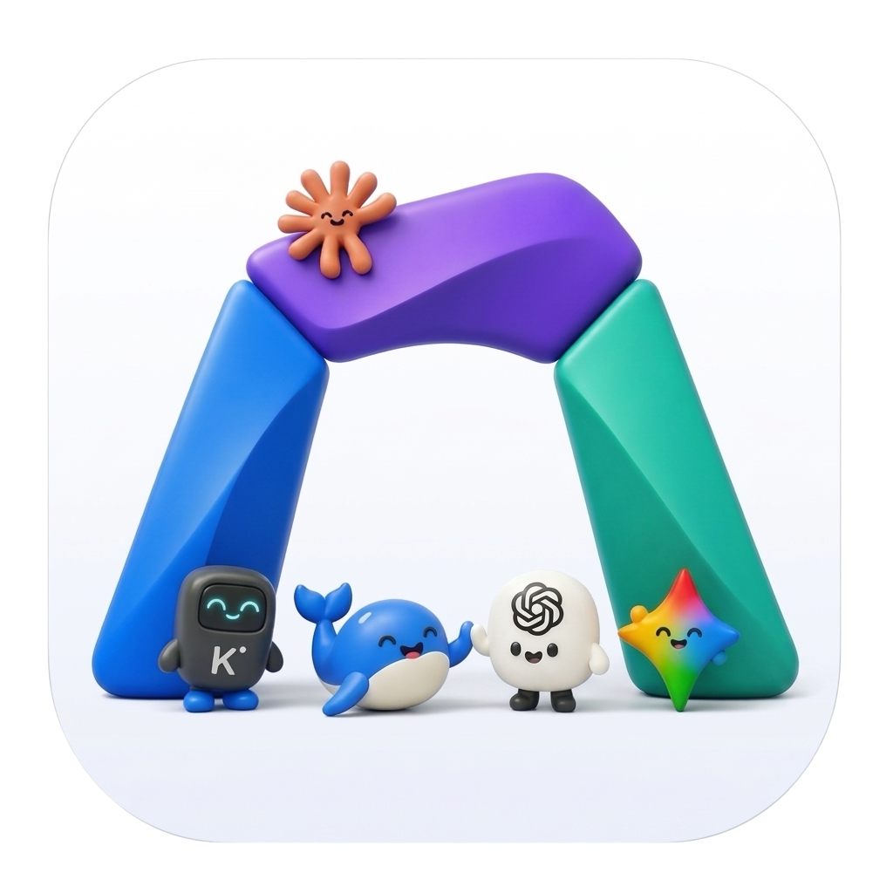
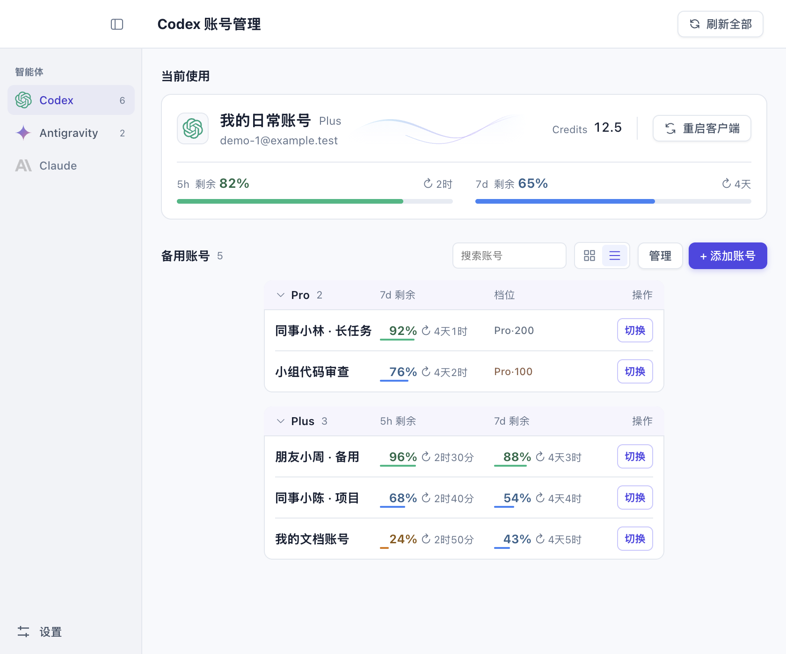
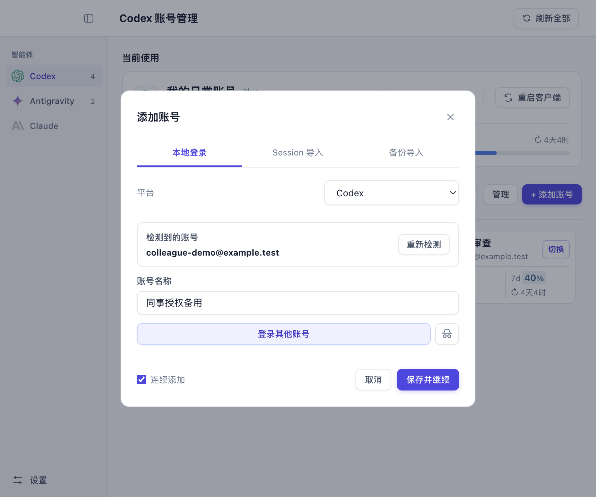
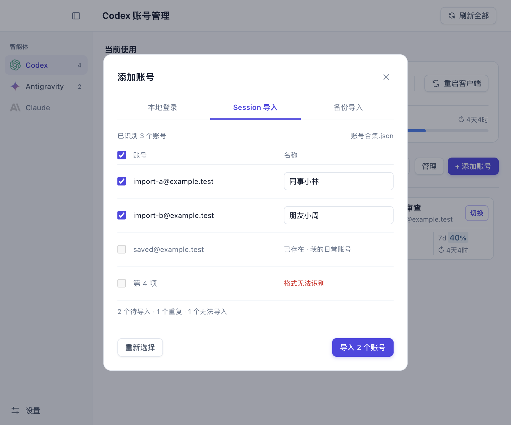
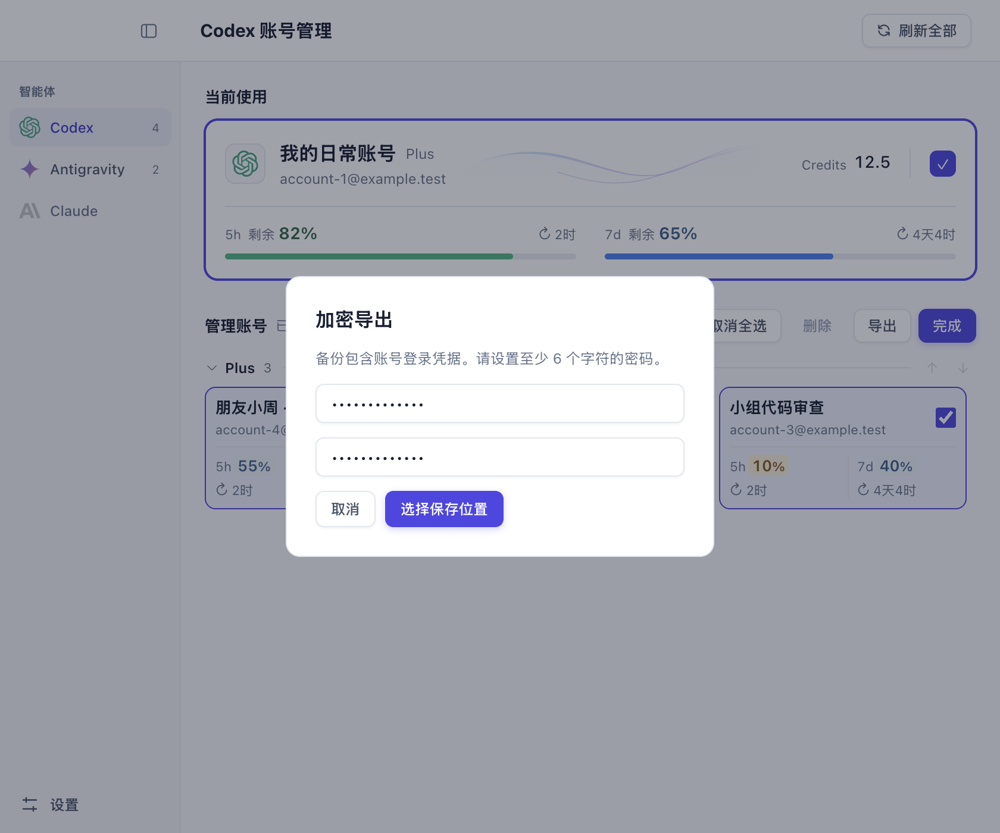
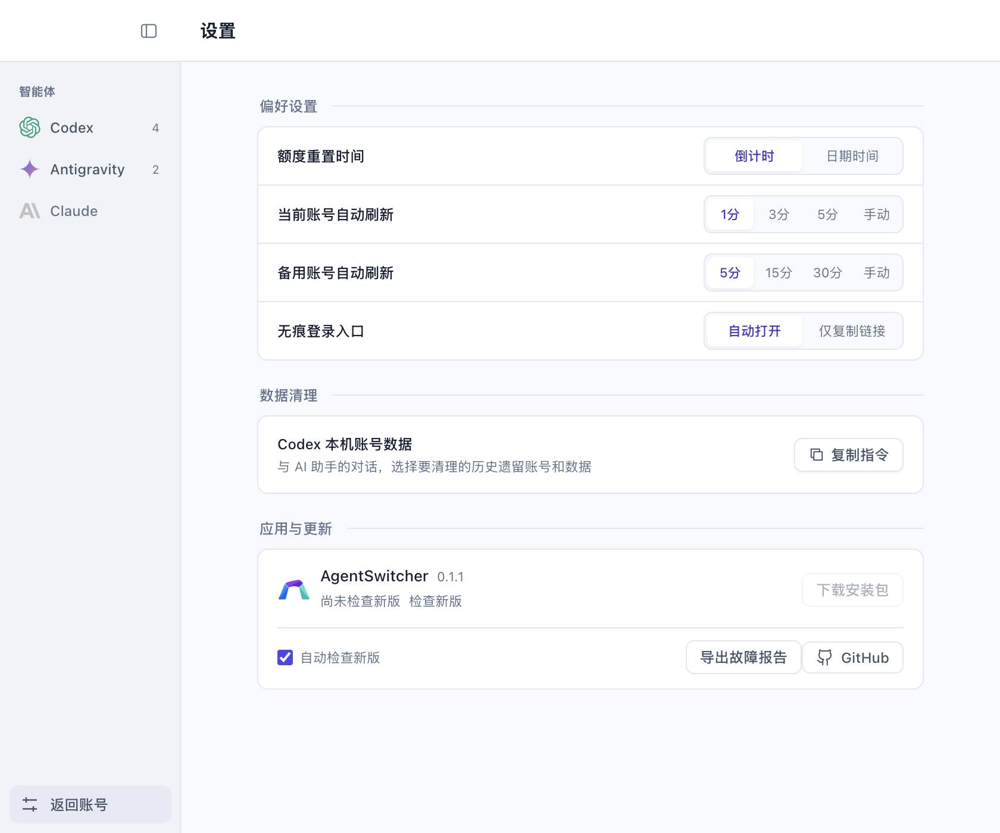

<div align="center">
  
  <h1>AgentSwitcher · AGS</h1>
  <p><a href="README.md">中文</a> · <strong>English</strong> · <a href="https://xjzc-mt.github.io/agent-switcher/?lang=en">Product website</a></p>
  <p><strong>Side by side with your agents, walking together toward the AGI gate.</strong></p>
  <p>
    Whether you juggle multiple personal and team accounts, or borrow a teammate’s <strong>Codex</strong> or <strong>Antigravity</strong> account in a crunch —<br />
    put them in one desktop window: see who still has quota left at a glance, switch in one click without breaking flow or overwriting your unsaved primary login.
  </p>
  <p>
    <a href="docs/release-0.1.1.md"></a>
    
    
    
    <a href="LICENSE"></a>
  </p>
  <p>
    <a href="https://github.com/xjzc-mt/agent-switcher/releases">Release history</a> ·
    <a href="#visual-tour">Visual Tour</a> ·
    <a href="#security--platform-support">Security &amp; Support</a> ·
    <a href="#quick-install">Quick Install</a> ·
    <a href="docs/release-0.1.1.md">0.1.1 Release Notes</a> ·
    <a href="#beyond-the-gate">✦ Beyond the Gate</a>
  </p>
</div>


<p align="center"><sub>Real desktop screenshots using mock accounts and simulated quotas (no real credentials included)</sub></p>

---

## Visual Tour

### 1. Check quota without guessing

Your active account stays pinned at the top while backup accounts are grouped by plan and sorted by remaining availability in **Card** or **Row** view. Codex separates `5h / 7d` windows and Credits; Antigravity leads with `Gemini` and shows `Claude / GPT` model groups independently, rendering missing values honestly as `—` without blending totals.

On macOS, click the AGS menu bar icon to immediately see your active quota and backup accounts in aligned two-column pills. Switching platforms keeps the menu on the same display.

| Codex Row View · Compact aligned comparison | Antigravity · Primary & secondary model groups |
| --- | --- |
|  |  |

### 2. Add accounts without signing out

Sign in through the official website to add accounts one after another **while your desktop client stays signed in**. On Windows, choosing private sign-in copies the link so you can paste it into a private browser window. Multi-account JSON imports let you preview, rename, and deduplicate by identity first; expired accounts can be refreshed in place while keeping their nickname, and replacement files verify ownership before overwriting (see [Import Format](docs/session-import.md)).

| Isolated Browser Login · Incognito & continuous add | Batch Import Preview · Rename, dedup & in-place update |
| --- | --- |
|  |  |

### 3. Back up and remove without collateral damage

Select accounts and set a dedicated password of at least 6 characters to export an encrypted `.ags` backup you can restore on another computer. Before removal, AGS lays out the exact matching scope — **by default only AGS backups are deleted**, leaving your official client login, chat history, and project files untouched.

| Encrypted Export · Password-protected `.ags` archive | Safe Removal · Keeps client state by default |
| --- | --- |
|  |  |

---

## Security & Platform Support

- **Zero custom backend, open to audit**: No proprietary servers, no analytics SDKs, and no telemetry. Sign-in only allows official OpenAI and Google auth domains, and you can also run straight from source.
- **Strong local encryption**: AGS encrypts stored credentials with `AES-256-GCM`. macOS Keychain or Windows DPAPI protects the master key for the current user. Exported `.ags` backups use a separate password.
- **No silent overwrites or side effects**: Switching away from an unsaved active login triggers a protection prompt first. AGS only swaps login credentials — never touching chat history or project configs, and never auto-switching in the background.
- **Clear boundaries**: Only add someone else’s account with explicit permission; this release is strictly local to your machine. See [Account Management Flow](docs/account-management.md) and [Quota Refresh](docs/refresh-behavior.md) for details (docs in Chinese).

| Platform | Status | Capabilities & Requirements |
| --- | :---: | --- |
| **Codex** (`codex`) | ✅ Supported | Isolated sign-in, `auth.json` switching, `5h / 7d` quota & Credits (uses the Codex CLI bundled with the desktop app or installed separately; Keychain-only storage is unsupported; API keys have no subscription quota) |
| **Antigravity** (`agy`) | ✅ Supported | Save, import, and manually switch personal Google accounts on macOS and Windows with just the Antigravity 2.x desktop app; model-group quotas and isolated browser sign-in require official `agy` 1.5.9+ CLI (enterprise auth is unverified) |

**0.1.1 Cross-Platform Status**: Verified installation, launch, and automated regression checks across macOS (Apple Silicon / Intel) and Windows x64. On Windows, AGS supports standalone or Microsoft Store Codex runtimes, fast native process & DPAPI inspection, and desktop-only Antigravity 2.x account switching; installing official `agy` 1.5.9+ and clicking **Recheck** unlocks quota queries. Two-account round trips on Mac and real-device end-to-end checks on Windows still await final sign-off.

---

## Quick Install

Existing `0.1.0` users can upgrade in one click inside **Settings → App & Updates → Install & Restart**. For fresh installs (or replacing an early `1.0.x` test build cleanly at `0.1.1` while keeping all saved accounts), run the one-line installer:

```bash
# macOS (requires macOS 13+, auto-detects Apple Silicon / Intel and installs into /Applications)
curl -fsSL https://xjzc-mt.github.io/agent-switcher/install.sh | bash
```

```powershell
# Windows x64 (PowerShell)
irm https://xjzc-mt.github.io/agent-switcher/install.ps1 | iex
```

Or download a `0.1.1` installer directly:
[macOS · Apple Silicon (DMG)](https://github.com/xjzc-mt/agent-switcher/releases/download/v0.1.1/AgentSwitcher-0.1.1-arm64.dmg) · [macOS · Intel (DMG)](https://github.com/xjzc-mt/agent-switcher/releases/download/v0.1.1/AgentSwitcher-0.1.1-x64.dmg) · [Windows · x64 (EXE)](https://github.com/xjzc-mt/agent-switcher/releases/download/v0.1.1/AgentSwitcher-Setup-0.1.1-x64.exe)

- **macOS** — Open the DMG and drag AGS into **Applications**. Finish active tasks in the official client before switching. With your confirmation, AGS quits and reopens the desktop client if it was running. For Antigravity, first close any `agy` or IDE sessions that share the login.
- **Windows** — Run the EXE installer. Finish any CLI or IDE sessions that share the login before switching; if the Codex desktop app is running, AGS can close and reopen it after your confirmation.

```bash
shasum -a 256 AgentSwitcher-*.dmg   # macOS. Compare the result with SHA256SUMS from the same release.
# Windows PowerShell: Get-FileHash .\AgentSwitcher-Setup-0.1.1-x64.exe
```

> [!IMPORTANT]
> macOS builds use **ad-hoc signing** (not yet Apple notarized). Installing via `install.sh` above verifies the signed manifest automatically; if you drag a DMG manually and macOS says the developer cannot be verified on first launch, check `SHA256SUMS`, then open **System Settings → Privacy & Security** and click **Open Anyway**.

If something goes wrong, open **Settings → App & Updates → Export diagnostic report** to save a redacted record of recent operations. You can share it privately with a maintainer. You can also check [Known Issues](issues/README.md) or file a report on [GitHub Issues](https://github.com/xjzc-mt/agent-switcher/issues). **Never upload real credential JSON, tokens, or backup passwords.**

<details>
<summary><strong>Preferences & In-App Updates</strong></summary>

In Settings, you can change the quota reset time display (countdown or date and time), configure separate auto-refresh intervals for active and backup accounts, choose how private sign-in works, and copy the Codex cleanup helper prompt.

Both macOS and Windows x64 can download the matching installer directly in AGS. The app verifies the release manifest with its bundled Ed25519 public key and checks SHA-256, then offers one-click **Install & Restart** to safely exit, update, and relaunch. [In-App Updates](docs/app-updates.md) · [GitHub Releases](https://github.com/xjzc-mt/agent-switcher/releases)



</details>

<details>
<summary><strong>Run from Source, <code>ags</code> CLI &amp; Developer Docs</strong></summary>

Requires **Node.js 22.12+**, npm, and a graphical desktop session (the DMG does not install the terminal command automatically; run `npm link` after building if you want `ags`):

```bash
git clone https://github.com/xjzc-mt/agent-switcher.git && cd agent-switcher
npm ci && npm run build && npm run gui

# Common CLI commands (close the desktop client before switching; unsaved active accounts require --save-current or --discard-current)
ags save codex work      # Save the current login
ags list                 # List saved accounts
ags status               # Inspect active status
ags use codex work       # Switch to a saved account
ags use agy work --allow-file-storage  # Opt in to storing long credentials in desktop & CLI private login files
ags rm codex work        # Preview removal scope (add --yes to apply, --logout to also sign out)

# Regression suite uses mock credentials; real Keychain integration tests are skipped by default
npm run lint && npm test && npm run test:ui
npm run screenshots      # Regenerate demo screenshots
npm run site:build       # Assemble GitHub Pages static bundle in out/site
npm run dist             # Build local DMG
```

Documentation index (Chinese): [Account Management](docs/account-management.md) · [Quota Refresh](docs/refresh-behavior.md) · [Session Import](docs/session-import.md) · [UI Design](docs/ui-design.md) · [In-App Updates](docs/app-updates.md) · [Releasing](docs/releasing.md) · [Package Size](docs/package-size.md) · [Screenshots](docs/images/README.md) · [MIT License](LICENSE)

</details>

---

## Beyond the Gate

<p>
  
  <strong>Beneath that "AGI Gate", humans walk with agents and lift each other up — AgentSwitcher is only the prologue.</strong>
</p>

A **next-generation personal micro-relay** built around **private trust circles · zero wasted quota · mutual help** is counting down to launch.

<details>
<summary><strong>🔮 Open the Gate · Read the Endgame Teaser</strong></summary>

Today, lending an account to a friend still means exporting credentials, while idle subscription windows quietly expire overnight. In the endgame vision, **anyone can run a self-controlled personal micro-relay** (not a public commercial pool or account reseller, just private mutual aid among close friends and small teams):

- **Share capacity, never credentials**: When your account sits idle, your machine becomes a lightweight micro-relay node so teammates can draw on spare capacity without ever receiving passwords or raw JSON.
- **Private trust circle by default, switches in your hands**: Open only to friends and small teams you approve; who connects, how much they can use, and external shutoff switches stay on your machine and revocable at any time.
- **Zero wasted quota**: Teammates can lean on your spare window when rushing a deadline, and you can borrow theirs when you sprint — getting full value out of every subscription.

> Click **`Star`** at the top right and subscribe via **`Watch → Custom → Releases`** so you’ll see the gate open first.

</details>

<sub>Note: This teaser previews an upcoming standalone product. AgentSwitcher is strictly local account and quota management with no online relay or sharing features.</sub>
