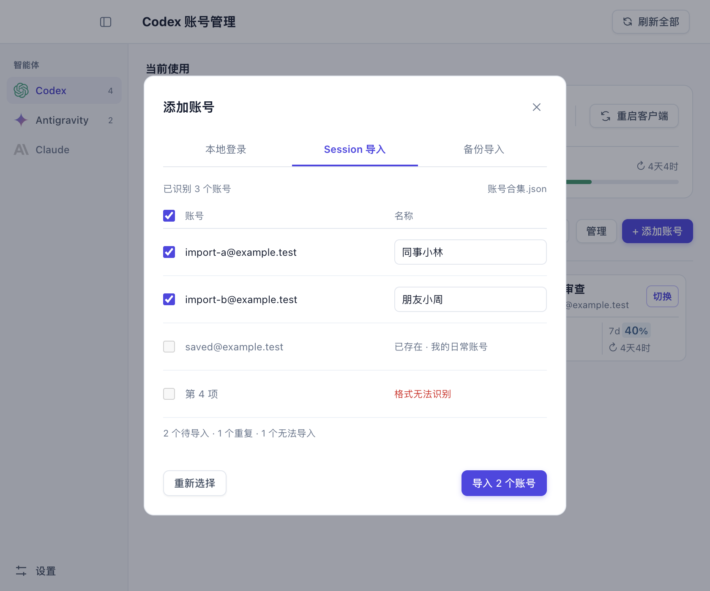
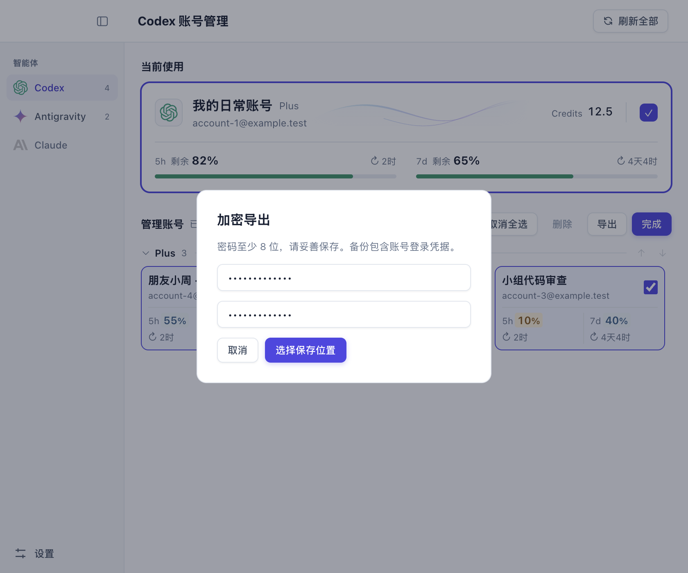
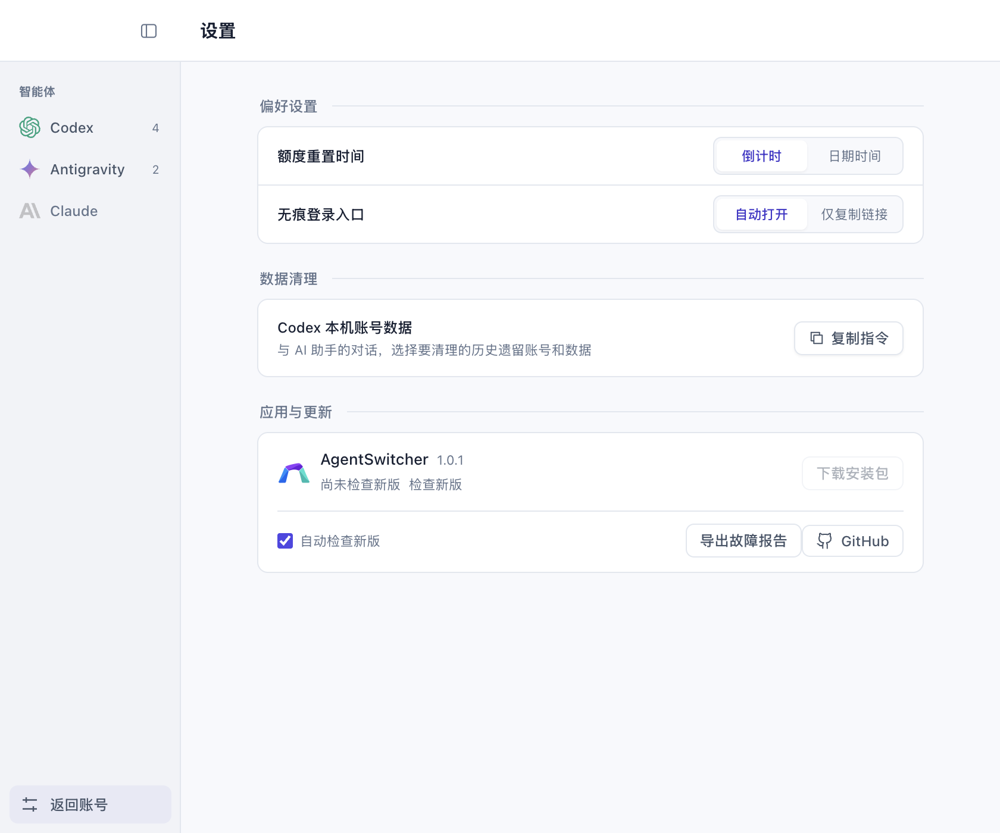

<div align="center">
  
  <h1>AgentSwitcher · AGS</h1>
  <p><strong>中文</strong> · <a href="README.en.md">English</a> · <a href="site/">产品主页源码 (GitHub Pages)</a></p>
  <p><strong>与 Agent 并肩，与伙伴同行，携手走向 AGI 之门。</strong></p>
  <p>
    不管你手头攒了多个个人号与团队号，还是搭档、朋友临时借你一个 <strong>Codex</strong>、<strong>Antigravity</strong> 账号救急——<br />
    放进同一个桌面窗口：谁还有余量一眼看清，点一下顺手切换，既不打断心流，也不误覆盖原有主号。
  </p>
  <p>
    <a href="docs/release-1.0.1.md"></a>
    
    
    
    <a href="LICENSE"></a>
  </p>
  <p>
    <a href="https://github.com/xjzc-mt/agent-switcher/releases">查看发布记录</a> ·
    <a href="#界面速览">界面速览</a> ·
    <a href="#安全与支持范围">安全与支持范围</a> ·
    <a href="#快速安装">快速安装</a> ·
    <a href="docs/release-1.0.1.md">1.0.1 版本说明</a> ·
    <a href="#门后的彩蛋">✦ 门后彩蛋</a>
  </p>
</div>


<p align="center"><sub>真实桌面界面演示截图（使用虚构账号与模拟额度，不含真实凭据）</sub></p>

---

## 界面速览

### 1. 看余量，不盲猜

当前账号置顶，备用账号按套餐归组、按可用余量排好序，支持**卡片**与**单行**两种视图。Codex 分列 `5h / 7d` 与 Credits；Antigravity 以 `Gemini` 为主并独立展示 `Claude / GPT` 等模型组，缺失值如实显示 `—`，不混算总比例。

| Codex 单行视图 · 密集对齐比对 | Antigravity · 模型组主次分层 |
| --- | --- |
|  |  |

### 2. 添账号，不掉线

拉起官方浏览器（支持无痕窗口与连续添加）独立完成授权，**不踢掉当前正在工作的客户端**。多账号 JSON 可先预览、改名、按身份去重再导入；过期账号可原位更新并保留昵称；从文件导入的替换凭据须先验证归属（详见 [导入格式](docs/session-import.md)）。

| 独立浏览器授权 · 支持无痕与连续添加 | 批量导入预览 · 改名、去重与过期替换 |
| --- | --- |
|  |  |

### 3. 留备份，不伤现场

勾选账号并设置独立密码即可导出 `.ags` 加密备份，方便跨机迁移。移除前先摊开确认范围，**默认只删 AGS 内的备份**，完整保留官方客户端登录、聊天历史与项目文件。

| 加密导出 · 独立密码保护 `.ags` 备份 | 移除确认 · 默认保留客户端现场 |
| --- | --- |
|  |  |

---

## 安全与支持范围

- **零自建后端，透明可审**：无自建服务器、无统计 SDK 与遥测上报；登录仅放行 OpenAI 与 Google 官方授权域名，也可直接从源码启动。
- **本机强加密**：账号凭据使用 `AES-256-GCM` 加密。macOS 钥匙串或 Windows 当前用户的 DPAPI 保护主密钥，导出的 `.ags` 备份使用独立密码。
- **不丢号、不越界**：未保存的当前登录在切换前会先弹窗提醒保护；只替换登录凭据，不动聊天记录与项目配置，也不会在后台自动切号。
- **边界清楚**：放入他人账号须事先获持有人授权；本版仅限本机使用。详细机制见 [账号管理流程](docs/account-management.md) 与 [额度刷新](docs/refresh-behavior.md)。

| 平台 | 状态 | macOS 支持与使用条件 |
| --- | :---: | --- |
| **Codex** (`codex`) | ✅ 已支持 | 独立登录、`auth.json` 切换、`5h / 7d` 额度与 Credits（需本机 Codex 客户端；Keychain-only 未适配，API Key 无订阅额度） |
| **Antigravity** (`agy`) | ✅ 已支持 | macOS 2.x 个人 Google 账号独立登录、Keychain 或官方文件切换与模型组额度（需官方 `agy` CLI；企业认证暂未验证） |
| **Claude Code** (`claude`) | 🚧 规划中 | 保留底层兼容代码，首版 GUI 入口暂置灰，待补齐激活与额度能力后开放 |

Windows x64 版的 Codex 登录、切换和额度仍待实机验收。Antigravity 原生切换与额度仅适用于 macOS。

---

## 快速安装

要从源码运行 **1.0.1**，在该版本的源码目录执行 `npm ci && npm run build && npm run gui` 即可体验。macOS 右上角菜单可悬停选择账号，切换平台时菜单会留在打开它的屏幕。参见 [1.0.1 版本说明](docs/release-1.0.1.md)。

1.0.1 安装包按系统和芯片选择。Mac 可在「关于本机」查看芯片。

[macOS · Apple Silicon（DMG）](https://github.com/xjzc-mt/agent-switcher/releases/download/v1.0.1/AgentSwitcher-1.0.1-arm64.dmg) · [macOS · Intel（DMG）](https://github.com/xjzc-mt/agent-switcher/releases/download/v1.0.1/AgentSwitcher-1.0.1-x64.dmg) · [Windows · x64（EXE）](https://github.com/xjzc-mt/agent-switcher/releases/download/v1.0.1/AgentSwitcher-Setup-1.0.1-x64.exe)

在 macOS 打开 DMG，将应用拖入「应用程序」。在 Windows 运行 EXE 安装。请先安装相应的官方客户端，切换前结束正在运行的任务。桌面客户端会在确认后退出并重开；Antigravity 共用登录的 `agy` 或 IDE 会话需先关闭。

```bash
shasum -a 256 AgentSwitcher-*.dmg   # macOS。将结果与同版 SHA256SUMS 对照。
# Windows PowerShell: Get-FileHash .\AgentSwitcher-Setup-1.0.1-x64.exe
```

> [!IMPORTANT]
> macOS 安装包采用 **ad-hoc 签名**（尚未接入 Apple 公证）。首次打开若提示无法验证开发者，核对来源后前往 **「系统设置 → 隐私与安全性」滑至底部点击「仍要打开」** 即可。

当前源码版可在「设置 → 应用与更新 → 导出故障报告」保存近期操作的脱敏记录，并自行决定是否私下转交维护者。也可查看[已知问题记录](issues/README.md)或到 [GitHub Issues](https://github.com/xjzc-mt/agent-switcher/issues) 反馈。**切勿上传真实凭据 JSON、Token 或备份密码**。

<details>
<summary><strong>偏好设置与应用内更新</strong></summary>

设置页支持切换重置时间格式（倒计时 / 日期时间）、无痕登录行为、复制 Codex 历史数据排查指令，以及在应用内检查与下载新版 DMG。当前源码使用内置 Ed25519 公钥验证发布清单，并核对安装包的 SHA-256。详见 [应用内下载更新](docs/app-updates.md)。



</details>

<details>
<summary><strong>源码运行、<code>ags</code> CLI 与开发者文档</strong></summary>

需要 **Node.js 22.12+**、npm 与图形桌面环境（DMG 不自动安装终端命令，需 `ags` 可在构建后执行 `npm link`）：

```bash
git clone https://github.com/xjzc-mt/agent-switcher.git && cd agent-switcher
npm ci && npm run build && npm run gui

# 常用 CLI（切换前请先手动关闭对应桌面客户端；未保存的当前账号需加 --save-current 或 --discard-current）
ags save codex work      # 保存当前登录
ags list                 # 查看已保存账号
ags status               # 查看当前激活状态
ags use codex work       # 切换至指定账号
ags use agy work --allow-file-storage  # 同意将长凭据保存到桌面与 CLI 各自的私有登录文件
ags rm codex work        # 预览移除范围（加 --yes 执行，加 --logout 同步登出）

# 回归使用演示凭据，真实钥匙串集成测试默认跳过
npm run lint && npm test && npm run test:ui
npm run screenshots      # 重新生成演示截图
npm run site:build       # 生成 GitHub Pages 静态站点到 out/site
npm run dist             # 本地构建 DMG
```

文档索引：[账号管理流程](docs/account-management.md) · [额度刷新](docs/refresh-behavior.md) · [Session 导入](docs/session-import.md) · [界面设计约定](docs/ui-design.md) · [应用内更新](docs/app-updates.md) · [构建与发布](docs/releasing.md) · [打包与体积](docs/package-size.md) · [截图说明](docs/images/README.md) · [MIT License](LICENSE)

</details>

---

## 门后的彩蛋

<p>
  
  <strong>顶部那扇「AGI 之门」下，人与众 Agent 并肩、人与人彼此托举——AgentSwitcher v1.0 只是序章。</strong>
</p>

一款围绕 **私密信任圈 · 额度零浪费 · 彼此互助** 打造的**划时代个人微中转产品**已进入发布倒计时，即将揭晓。

<details>
<summary><strong>🔮 点击推开高门 · 解锁「终局形态」预言</strong></summary>

今天朋友借号还得导凭据，深夜里大量订阅窗口又在倒计时中白白清零。而在终局形态里，**每个人都可以是一座自主受控的「个人小中转」**（并非公共商业号池或账号倒卖，而是熟人与小团队的私密互助工具）：

- **借力免交凭据**：账号空闲时，本机即可化作轻量微中转节点，搭档按需借力，无需交出密码或明文 JSON。
- **信任圈私密默认，开关全权在己**：默认仅对认可的熟人与小团队开放；谁能连、用多少、外部限制开关均由你本机实时掌控、随时撤回。
- **闲置余量零浪费**：队友赶工借你空闲窗口顶上，你冲刺时也有伙伴余量接力，让每一份订阅物尽其用。

> 先点亮右上角 **`Star`** 并在 **`Watch → Custom → Releases`** 订阅通知——当那扇门真正敞开时，第一时间见。

</details>

<sub>注：彩蛋为下一代独立产品预言；AgentSwitcher 仅提供纯本机账号与额度管理，不含联网中转或共享功能。</sub>
