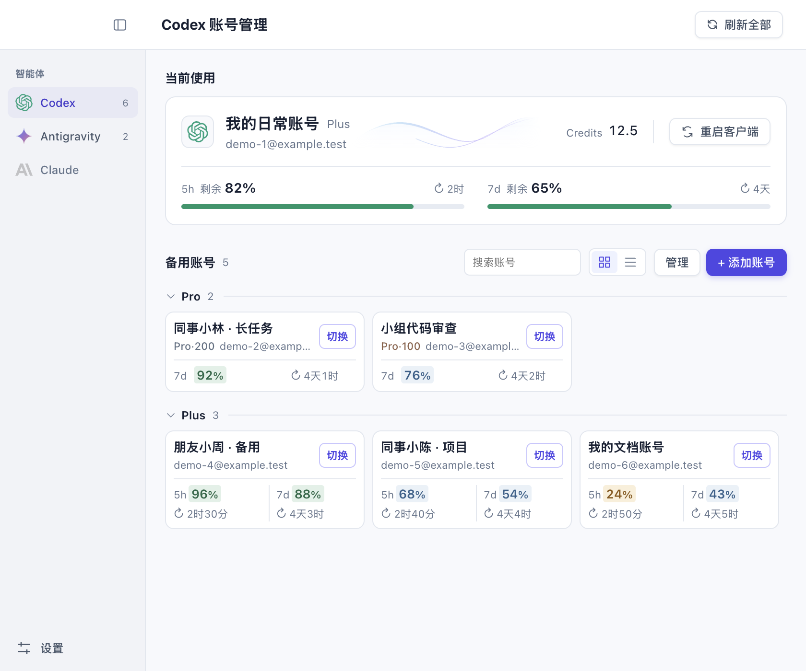
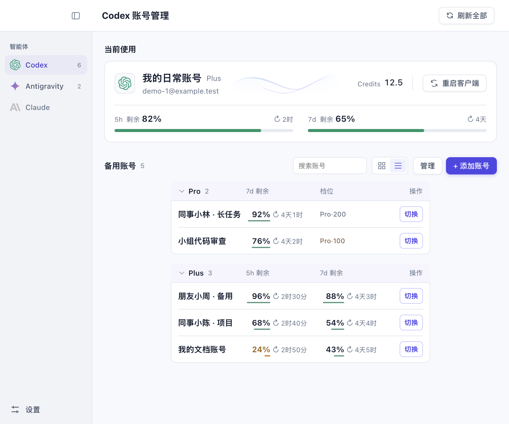
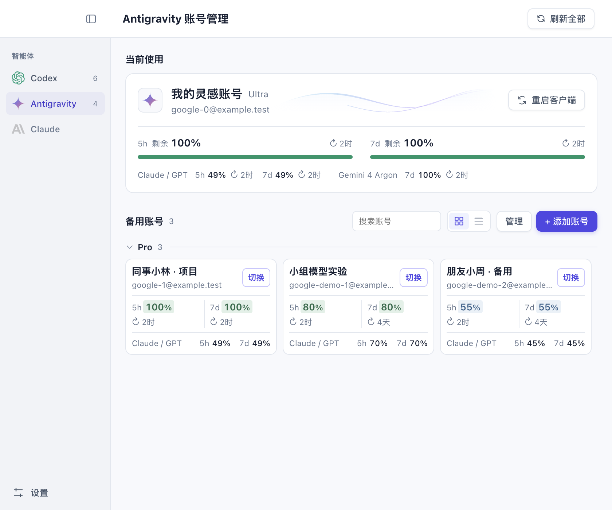
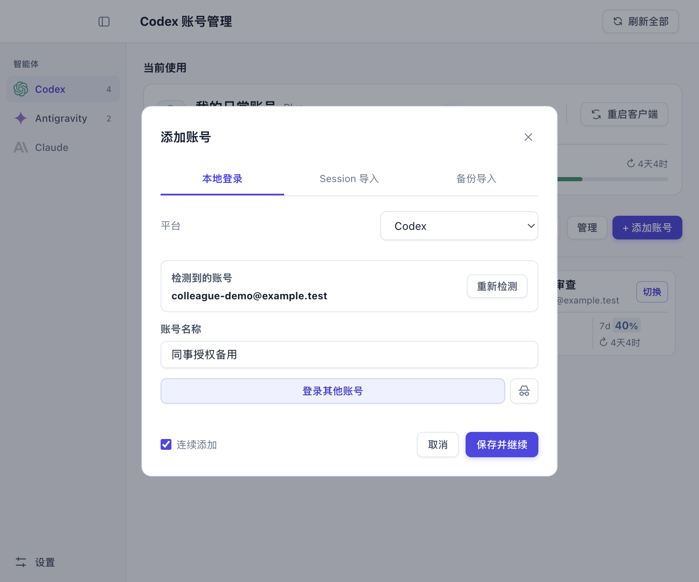
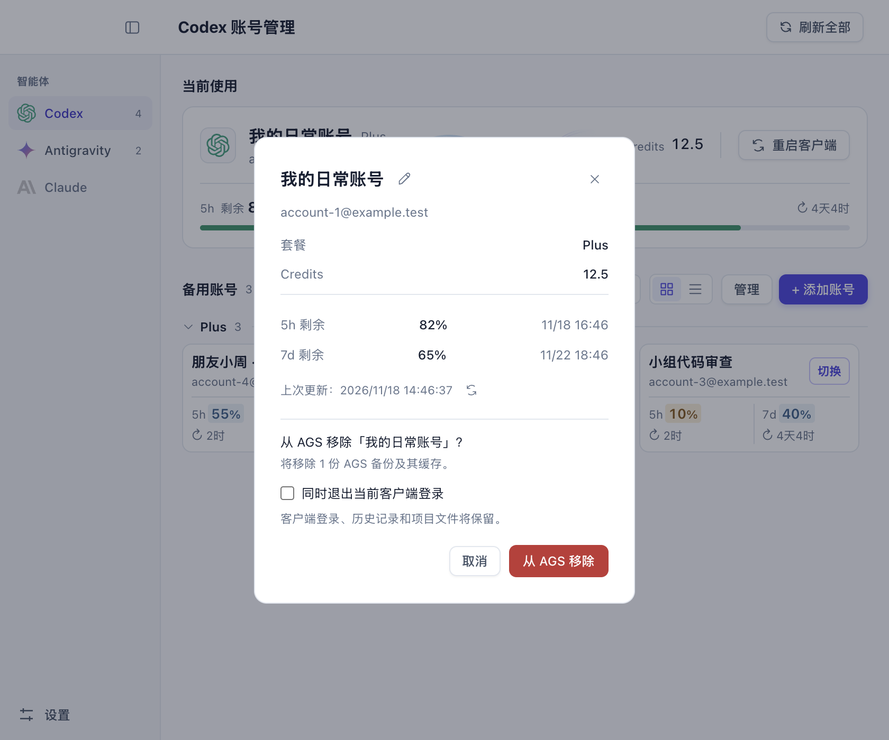

# AgentSwitcher · AGS

**账号放一起，额度看得清，切换更顺手。**

AGS 是面向 AI 编程工具的本地账号与额度管理器。把自己常用的账号，以及同事、朋友授权使用的 Codex、Antigravity 账号放进一个桌面窗口：看看谁还有额度，选好账号再切换，少一些反复登录和逐个查询。

[首发说明](docs/release-1.0.0.md) · [下载安装包](https://github.com/xjzc-mt/agent-switcher/releases) · [使用与安全边界](docs/account-management.md) · [反馈问题](https://github.com/xjzc-mt/agent-switcher/issues)

> v1.0.0 桌面版面向 **macOS Apple Silicon**，支持从源码运行。安装包和配套校验文件随稳定版一同提供。



*以下均为真实应用界面的演示截图，使用虚构账号与模拟额度，不包含真实凭据。*

## 日常使用，少几次来回

| 你想做的事 | AGS 怎么帮你 |
| --- | --- |
| 找到还有额度的账号 | 同屏查看当前与备用账号，按套餐分组和可用额度排序 |
| 快速选中工作账号 | 卡片 / 单行视图、搜索、改名与分组折叠 |
| 分清自己、同事和朋友的账号 | 用容易识别的昵称标注来源和用途，按任务选择 |
| 添加账号，不打断当前登录 | 独立官方浏览器授权，核对邮箱后保存；支持连续添加 |
| 一次整理多个账号 | 导入完整客户端凭据，先预览、命名、勾选，再按身份去重 |
| 凭据过期后继续使用 | 重新登录或导入新凭据，核对身份后原位更新，保留账号名称 |
| 换机器或留一份备份 | 选择账号，导出由独立密码加密的 `.ags` 文件 |

### 额度一眼可见，账号多也好找

当前账号单独展示，备用账号按套餐归组。卡片适合浏览，单行视图便于集中比较；按各套餐的实际额度周期展示，缺失值用「—」标记，不当成零。

自己的账号留给日常开发，同事授权的备用账号接手长任务，朋友提供的账号用来体验另一款工具——用名称记住来源与用途，下次协作时一眼就能找到适合的账号。



Antigravity 按实际返回的模型组展示额度：Gemini 为主，Claude / GPT 等额度保留各自含义，不合成一个容易误解的总百分比。



### 登录一次，留作备用

「添加账号 → 本地登录」使用官方授权页面。普通与无痕入口共用同一次独立登录，授权后回到 AGS 核对邮箱并保存；添加备用账号不会切换当前客户端账号。



<details>
<summary><strong>批量导入：先看清，再保存</strong></summary>

选择 JSON 文件或粘贴完整客户端凭据，逐项预览、改名和勾选。重复账号按身份识别，同邮箱不同工作区不会直接合并。已失效账号可原位更新。


支持单个 / 多个账号及常见 JSON 包装。文件最多 32 MB、一次最多 200 个账号；不接受来源不明的单段 Token 或浏览器 Cookie。详见 [导入格式](docs/session-import.md)。

</details>

<details>
<summary><strong>备份与移除：范围明确，由你确认</strong></summary>

在「管理」中选择账号，使用独立密码导出加密备份。跨机器迁移时，通过「添加账号 → 备份导入」恢复。


移除前先列出账号及同身份备份范围。默认只移除 AGS 内的备份，保留官方客户端登录、项目和历史；受支持的当前账号可明确选择同时退出登录。



</details>

## 几分钟开始使用

### 1. 安装与准备

从 [Releases](https://github.com/xjzc-mt/agent-switcher/releases) 下载 `AgentSwitcher-1.0.0-arm64.dmg` 与同版 `SHA256SUMS`，放在同一目录，核对文件：

```bash
shasum -a 256 -c SHA256SUMS
```

退出旧版 AGS，打开 DMG，将 `AgentSwitcher.app` 拖入「应用程序」。当前候选包使用 ad-hoc 签名，尚无 Developer ID 签名和 Apple 公证；若系统阻止打开，核对来源后通过 macOS「隐私与安全性」按提示批准打开。

需要安装对应官方客户端：Codex 使用本机 Codex CLI / app-server；Antigravity 的独立登录和额度查询需要官方 `agy` CLI。当前实测环境与兼容范围见 [账号管理流程](docs/account-management.md)。

### 2. 添加账号

选择 Codex 或 Antigravity，点击「添加账号」：

- **本地登录**：保存已检测到的当前账号，或通过浏览器独立登录后保存。
- **Session 导入**：导入完整客户端 JSON，支持多账号预览。
- **备份导入**：恢复 `.ags` 密码备份，也兼容旧 ZIP 备份。

### 3. 看额度，按需切换

额度会按需刷新，也可手动刷新全部，或在账号详情中刷新单个账号。查询失败时保留并标明历史记录；凭据失效会提供更新入口。详见 [刷新机制](docs/refresh-behavior.md)。

切换前先结束正在进行的任务。GUI 会在确认后正常退出正在运行的对应桌面客户端，写入所选凭据并尝试重开；原本未运行的客户端不会自动启动。已有终端会话需要自行重启。AGS 不会按额度自动切换账号。

### 4. 按自己的习惯设置

在设置中选择额度重置时间的显示方式、无痕登录入口的行为，以及是否自动检查新版。应用内可下载并校验新版 DMG，安装时仍由你退出应用、拖入替换。


无痕入口支持 macOS 上的 Chrome / Chromium、Edge、Brave 和 Firefox；未适配浏览器或打开失败时复制同一授权链接。无法访问公开 Release 时，更新入口显示暂未取得可用版本，不把查询失败当作已是最新。

## 本地保存，也把操作边界说清楚

- **账号池加密**：凭据使用 AES-256-GCM 加密，macOS 主密钥由 Keychain 保管；账号文件权限为 `0600`。旧明文逐文件验证后迁移，失败保留原文件，不降级为明文写入。
- **备份独立加密**：`.ags` 使用 AES-256-GCM + scrypt，由你设置密码。跨机器迁移请导出备份，不直接复制加密账号池。
- **身份核对与写入保护**：按稳定身份区分账号和工作区；切换、导入和续期回存保留凭据版本检查，避免旧凭据覆盖新登录。
- **操作范围明确**：切换只处理登录凭据，不迁移聊天记录、项目清单或模型 / MCP 配置。「数据清理」仅复制检查指令，不执行删除。
- **网络按功能使用**：官方登录、续期与额度查询需要访问平台服务；应用更新访问 GitHub Releases。AGS 不是离线工具，本地加密也不能保护已被控制的操作系统或官方客户端中的凭据。

协作场景中的账号需由账号持有人授权使用。当前账号池保存在本机，AGS 不提供跨设备同步、共享额度分配或多人并发协调。

账号池与设置位于 `~/.agent-switcher/`，应用标识为 `com.agent-switcher.app`。自动续期与外部登录仍可能受服务端 Token 撤销策略影响，明确失效时需要重新登录。[完整安全与删除流程 →](docs/account-management.md)

## 首版支持范围

| 平台 | 首版能力 | 当前边界 |
| --- | --- | --- |
| **Codex** | 独立登录、文件凭据保存与切换、当前 / 备用账号订阅额度 | 使用 `CODEX_HOME` 或 `~/.codex/auth.json`；Keychain-only 登录未适配，API Key 不显示订阅额度 |
| **Antigravity** | macOS 2.x 个人账号独立授权、Keychain 切换、套餐与模型组额度 | 需要官方 `agy` CLI；企业认证及其他系统的新认证未验证 |
| **Claude Code** | 保留已有数据与底层适配代码 | 首版 GUI 暂不开放，入口置灰 |

首发安装包仅面向 Apple Silicon Mac。Intel Mac、Windows、Linux 未做安装验收；当前也没有单独接入 Gemini CLI。已有真实账号验证范围见 [账号管理流程](docs/account-management.md)，不代表所有官方客户端版本均兼容。

## 从源码运行与 CLI

需要 Node.js 22.12+、npm 和图形桌面环境。

```bash
git clone https://github.com/xjzc-mt/agent-switcher.git
cd agent-switcher
npm ci
npm run build
npm run gui
```

DMG 不安装终端命令。需要 `ags` 时，在源码目录执行 `npm link`，保留源码目录与依赖：

```bash
ags save codex work      # 保存本机当前登录
ags list                # 查看已保存账号
ags status              # 查看当前状态
ags use codex work       # 先手动退出对应桌面客户端
ags rm codex old-account # 预览移除范围；确认后加 --yes
ags gui
```

CLI 平台标识为 `codex`、`agy`、`claude`，受各平台实际适配范围限制。当前账号未入池时，`use` 需要明确选择 `--save-current` 或 `--discard-current`；删除默认保留客户端登录，受支持场景可另加 `--logout`。源码 CLI 与桌面安装包分别更新。

## 开发与反馈

```bash
npm run lint
npm test
npm run test:ui
npm run screenshots     # 用演示数据重新采集 README 截图
npm run dist            # 本机架构安装包，仅构建，不发布
npm run size:audit
```

业务测试使用临时账号目录与假凭据；UI 测试使用隔离浏览器数据和模拟 preload。回归截图写入忽略目录 `test-results/ui/`，README 演示图位于 `docs/images/`。打包仅收录应用代码、资源和运行依赖。

问题反馈请附应用版本、系统版本、对应客户端版本及复现步骤；截图中隐去账号信息，不提交凭据 JSON、Token 或备份密码。

[发布流程](docs/releasing.md) · [打包与体积](docs/package-size.md) · [MIT License](LICENSE)

## 下一站，让闲置的能力流动起来

一个关于**互联互通、按需取用、彼此互助的个人中转产品**即将揭晓。让暂时闲置的资源遇见真正需要它的人，让每一份能力少些浪费，让个人之间的连接更有价值。

这是下一款产品的预告；本版 AGS 专注于你本机的账号与额度管理。更多细节，后续见。
